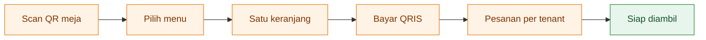

<div align="center">

# 🍽️ KantinKu

### Satu meja. Banyak pilihan. Satu pembayaran.

Pesan makanan lintas tenant dari meja kantin kampus.<br />
Scan QR, pilih menu, dan ikuti progres pesanan dari ponsel.

     

[Kenali proyek](#tentang-proyek) · [Mulai lokal](#jalankan-di-lokal) · [Progres](#status-pengembangan) · [Dokumentasi](#dokumentasi)

</div>

---

## Tentang proyek

KantinKu menyatukan pemesanan dari beberapa penjual dalam satu kantin. Pembeli tidak perlu membuat akun untuk melihat menu atau menyiapkan pesanan. Setiap tenant memiliki area kerja sendiri, sedangkan pengelola menangani operasional kantin.

Alur yang dituju adalah satu pembayaran QRIS untuk menu dari beberapa tenant, lalu pesanan diteruskan ke penjual masing-masing. **Integrasi pembayaran dan antrean realtime masih dalam pengembangan.**

## Satu aplikasi, tiga area

| Area | Untuk siapa | Fungsi yang dituju |
| :--- | :--- | :--- |
| 📱 **Pembeli** | Pengunjung kantin | Scan QR meja, cari menu, keranjang lintas tenant, bayar QRIS, pantau pesanan |
| 🍳 **Tenant** | Penjual makanan dan minuman | Terima pesanan, kelola menu, atur stok dan jam buka, lihat rekap |
| 🧾 **Pengelola & kasir** | Operator kantin | Pesanan tunai, pengelolaan tenant dan meja, laporan bagi hasil, refund |

## Dari meja ke dapur



*Skenario produk yang dituju. Beberapa tahap masih berupa tampilan demo.*

## Status pengembangan

Status berikut menggambarkan kode yang sudah tersedia di branch `main`.

| Bagian | Status |
| :--- | :--- |
| Fondasi database, RLS, dan data seed | ✅ Tersedia |
| Menu pembeli dari QR meja dengan data Supabase | ✅ Tersedia |
| Keranjang lintas tenant, catatan, dan penyimpanan lokal | ✅ Tersedia |
| Login staf dan pembatasan akses per peran | ✅ Tersedia |
| Pengelolaan menu tenant dan status buka/tutup | 🚧 Integrasi bertahap |
| Checkout QRIS dan konfirmasi pembayaran | 🚧 Dalam pengembangan |
| Antrean realtime dan status pesanan | 🎨 Tampilan demo |
| Kasir, laporan, bagi hasil, dan refund | 🎨 Tampilan demo |

Rincian pekerjaan dan acceptance criteria ada di [rencana build MVP](docs/TASKS.md).

## Teknologi

| Lapisan | Teknologi |
| :--- | :--- |
| Aplikasi | Next.js App Router, React, TypeScript |
| Antarmuka | Tailwind CSS, shadcn/ui, Lucide |
| Data & autentikasi | Supabase Postgres, Auth, Realtime, Storage |
| Validasi | Zod |
| Pembayaran yang direncanakan | Xendit QRIS |
| Pengujian database | PGlite |

## Jalankan di lokal

Siapkan **Node.js**, **npm**, **Supabase CLI**, dan **Docker**. Di macOS, Docker dapat dijalankan melalui OrbStack atau Docker Desktop.

**1. Ambil proyek dan pasang dependency**

```bash
git clone https://github.com/Nuzzy32/Kantinku.git
cd Kantinku
npm install
```

**2. Jalankan Supabase lokal**

```bash
supabase start
cp .env.example .env.local
supabase status -o env
```

Salin konfigurasi Supabase ke `.env.local`:

| Dari Supabase | Variabel aplikasi |
| :--- | :--- |
| `API_URL` | `NEXT_PUBLIC_SUPABASE_URL` |
| `PUBLISHABLE_KEY` | `NEXT_PUBLIC_SUPABASE_PUBLISHABLE_KEY` |
| `SECRET_KEY` | `SUPABASE_SECRET_KEY` |

Isi juga `SEED_PASSWORD` dengan password akun contoh yang kamu pilih sendiri. Secret key hanya digunakan di server. Jangan unggah `.env.local` ke repository.

**3. Isi data contoh dan jalankan aplikasi**

```bash
npm run seed
npm run dev
```

| Halaman lokal | Alamat |
| :--- | :--- |
| Daftar layar pengembangan | [localhost:3000](http://localhost:3000) |
| Menu contoh Meja 34 | [Buka menu pembeli](http://localhost:3000/t/00000000-0000-4000-8000-000000000034) |
| Login tenant | [localhost:3000/tenant/login](http://localhost:3000/tenant/login) |
| Login pengelola & kasir | [localhost:3000/admin/login](http://localhost:3000/admin/login) |
| Supabase Studio | [127.0.0.1:54323](http://127.0.0.1:54323) |

Seed menyiapkan **1 kantin, 3 tenant, 10 menu, 5 meja**, serta akun staf dengan domain `@kantinku.test`. Lihat [script seed](scripts/seed.mjs) untuk alamat akunnya. Beberapa layar masih memakai data contoh dari `lib/mock.ts`; menu pembeli dan login membutuhkan Supabase.

## Perintah pengembangan

| Perintah | Kegunaan |
| :--- | :--- |
| `npm run dev` | Jalankan aplikasi lokal |
| `npm run build` | Buat build produksi dan periksa tipe |
| `npm run lint` | Periksa kualitas kode |
| `npm run test:schema` | Uji aturan bisnis database dan RLS tanpa Docker |
| `npm run seed` | Isi data contoh ke Supabase lokal |
| `npm run types` | Perbarui tipe TypeScript dari skema Supabase lokal |

## Struktur proyek

```text
app/                   Halaman pembeli, tenant, admin, dan server actions
components/            Komponen UI per area pengguna
lib/                   Auth, menu, keranjang, tipe, dan klien Supabase
supabase/migrations/   Migration database
docs/                  Arsitektur, rencana fitur, skema, dan tes
design/                Spesifikasi layar dan aturan visual
scripts/               Seed data pengembangan
```

## Dokumentasi

| Dokumen | Isi |
| :--- | :--- |
| [Arsitektur](docs/ARCHITECTURE.md) | Model data, alur pembayaran, akses, dan integrasi |
| [Rencana MVP](docs/TASKS.md) | User stories, dependensi, dan acceptance criteria |
| [Spesifikasi UI](design/UI-SPEC.md) | Layar, komponen, dan perilaku antarmuka |
| [Skema database](docs/schema.sql) | Tabel, RLS, fungsi transaksi, dan bagi hasil |
| [Tes database](docs/schema.test.mjs) | Pengujian aturan bisnis dan isolasi data |

---

<div align="center">
  <strong>KantinKu</strong><br />
  <sub>Dikembangkan untuk alur pesan makanan di kantin kampus.</sub>
</div>
